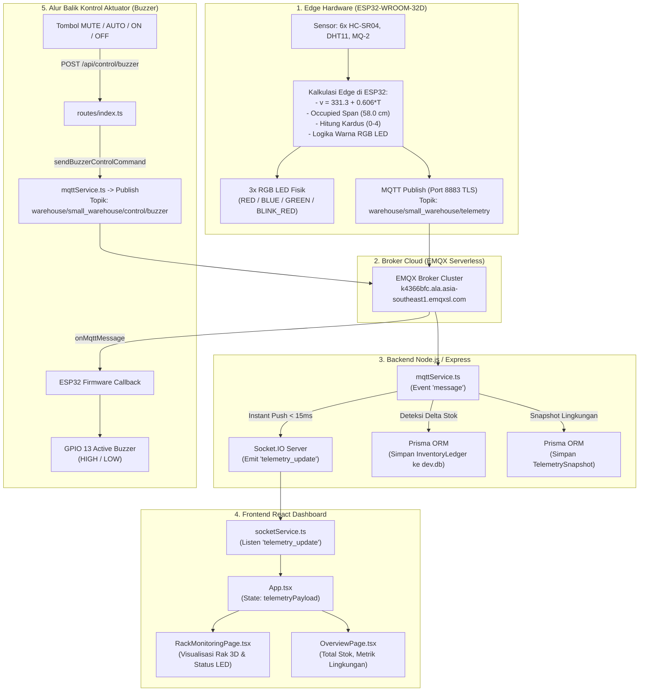

# 📐 DOKUMENTASI ARSITEKTUR FULLSTACK
## Smart Small Rack Warehouse IoT (Pure Edge Computing)

> **Dokumen Arsitektur Sistem:**
> Dokumen ini membedah arsitektur teknis, struktur direktori, alur data *end-to-end*, mekanisme kontrol aktuator, dan peran setiap file penting dalam proyek **Smart Small Rack Warehouse IoT**.

---

## 🏛️ 1. Filosofi Arsitektur: Pure Edge Computing

Sistem ini dirancang dengan prinsip **Edge Computing Murni pada Mikrokontroler (ESP32)**:
* **ESP32 (Edge Node):** Bukan sekadar pemancar sensor mentah, melainkan unit komputasi independen. ESP32 membaca 6 sensor ultrasonik HC-SR04, mengompensasi kecepatan suara menggunakan suhu udara dari DHT11, mengukur rentang terisi (*occupied span*) berdasarkan dimensi fisik ambalan tetap **58.0 cm**, menghitung jumlah kardus per lantai (kapasitas 4 kardus @ 14.5 cm), menentukan status lantai, dan mengendalikan 3 indikator RGB LED fisik secara independen.
* **Broker MQTT (EMQX Serverless Cloud):** Menyalurkan pesan telemetri dan perintah kontrol secara aman melalui protokol **MQTT over TLS/SSL (Port 8883)**.
* **Backend (Node.js + Express + Prisma + SQLite):** Bertindak sebagai *IoT Ingestion Engine*, pencatat audit mutasi stok (*Inventory Ledger*), penyimpan riwayat sensor (*Telemetry Snapshot*), serta *Real-time Gateway* via Socket.IO.
* **Frontend (React + TypeScript + Tailwind CSS):** Bertindak sebagai *Presentation Layer* murni yang merefleksikan kondisi fisik rak (*Digital Twin*) secara reaktif tanpa perlu melakukan kalkulasi stok ulang di browser.

---

## 🗺️ 2. Diagram Alur Sistem (Architecture Flowchart)



---

## 📂 3. Struktur Direktori Lengkap (Directory Tree)

```text
Dashboard IoT/
├── firmware/
│   └── esp32_smart_rack/
│       └── esp32_smart_rack.ino      # Source code C++ Arduino ESP32 (Logika Edge Computing)
│
├── backend/                          # Backend Node.js + Express
│   ├── prisma/
│   │   └── schema.prisma             # Skema Database SQLite (ORM Prisma)
│   ├── src/
│   │   ├── config/
│   │   │   ├── database.ts           # Koneksi Prisma Client
│   │   │   └── index.ts              # Loader environment variable & topik MQTT
│   │   ├── controllers/
│   │   │   ├── inventoryController.ts# API riwayat mutasi stok (Ledger)
│   │   │   ├── productController.ts  # API master produk / SKU kardus
│   │   │   ├── rackController.ts     # API overview rak fisik
│   │   │   └── sensorController.ts   # API sensor & ambang batas bahaya
│   │   ├── middleware/
│   │   │   └── errorHandler.ts       # Penanganan error global HTTP
│   │   ├── routes/
│   │   │   └── index.ts              # Router Express (/control/buzzer, /racks, dll)
│   │   ├── services/
│   │   │   └── mqttService.ts        # Client MQTT, listener telemetri & broadcast Socket.IO
│   │   ├── types/
│   │   │   └── index.ts              # Type definitions backend (kontrak JSON MQTT & Actuator)
│   │   ├── utils/
│   │   │   ├── helpers.ts            # Helper generator nomor transaksi (TX-xxxx)
│   │   │   └── stockCalculator.ts    # Kompensasi kecepatan suara & fallback kalkulasi
│   │   ├── server.ts                 # Entry point server HTTP Express & Socket.IO
│   │   └── simulator.ts              # Simulator hardware virtual untuk pengujian tanpa ESP32
│   ├── .env                          # Kredensial EMQX, port, dan threshold bahaya
│   └── package.json
│
├── src/                              # Frontend React + TypeScript + Tailwind CSS
│   ├── components/
│   │   ├── layout/
│   │   │   ├── Header.tsx            # Bar status sistem, indikator WS AKTIF/TERPUTUS
│   │   │   ├── Sidebar.tsx           # Navigasi antar halaman
│   │   │   └── SimulatorDrawer.tsx   # Panel drawer kontrol cepat
│   │   ├── tutorial/                 # Komponen scene tutorial visual interaktif gudang
│   │   └── ui/
│   │       └── StatusBadge.tsx       # Badge indikator status UI
│   ├── pages/
│   │   ├── OverviewPage.tsx          # Ringkasan KPI, total kardus, suhu DHT11, gas MQ-2
│   │   ├── RackMonitoringPage.tsx    # Visualisasi Rak 3D, 3 RGB LED per baris, inspektor detail
│   │   ├── InventoryHistoryPage.tsx  # Tabel audit mutasi stok (Stock In / Stock Out)
│   │   ├── SensorMonitoringPage.tsx  # Grafik telemetri sensor lingkungan
│   │   ├── ProductManagementPage.tsx # Pengaturan master barang & dimensi kardus
│   │   └── SettingsPage.tsx          # Halaman pengaturan sistem
│   ├── services/
│   │   ├── iotApiService.ts          # Axios client untuk request REST API ke Backend
│   │   └── socketService.ts          # Client Socket.IO listener & fungsi sendBuzzerCommand
│   ├── types/
│   │   └── index.ts                  # Type definitions TypeScript (TelemetryPayload, FloorTelemetry)
│   ├── utils/
│   │   └── stockCalculator.ts        # Utility helper dimensi visual
│   ├── App.tsx                       # Root State Manager (menghubungkan WebSocket ke Page)
│   └── main.tsx                      # Entry point React DOM
├── package.json
├── tailwind.config.js
└── vite.config.ts
```

---

## ⚡ 4. Alur Data Telemetri (End-to-End Detail)

### Tahap 1: Pembacaan Sensor & Komputasi Lokal di ESP32
* **File Terkait:** `firmware/esp32_smart_rack/esp32_smart_rack.ino`
* **Mekanisme:**
  1. Sensor **DHT11** (GPIO 4) mengukur suhu ($T$). Kecepatan suara dikompensasi:
     $$v = 331.3 + (0.606 \times T) \text{ m/s}$$
  2. Enam sensor ultrasonik **HC-SR04** (Shared TRIG GPIO 27) membaca jarak pantulan kiri ($D_L$) dan kanan ($D_R$) pada Lantai 1, 2, dan 3.
  3. Rentang terisi dihitung dengan panjang ambalan mutlak **58.0 cm**:
     $$\text{Occupied Span} = 58.0 - (D_L + D_R)$$
  4. Jumlah kardus per baris rak dihitung dengan lebar standar kardus **14.5 cm**:
     $$\text{Item Count} = \text{round}\left(\frac{\text{Occupied Span}}{14.5}\right) \quad \text{(Rentang: 0 sampai 4)}$$
  5. Status dan warna LED ditentukan langsung di ESP32:
     - `0 kardus` $\rightarrow$ Status `EMPTY` $\rightarrow$ Warna LED **RED**
     - `1 - 3 kardus` $\rightarrow$ Status `PARTIAL` $\rightarrow$ Warna LED **BLUE**
     - `4 kardus` $\rightarrow$ Status `FULL` $\rightarrow$ Warna LED **GREEN**
     - `Bahaya Gas > 600 ppm / Suhu > 50°C` $\rightarrow$ Status `ALARM` $\rightarrow$ Warna LED **BLINK_RED**
  6. Dokumen JSON disusun dan dikirim menggunakan `WiFiClientSecure` ke topik:
     `warehouse/small_warehouse/telemetry`

### Tahap 2: Ingestion & Broadcast Cepat di Backend
* **File Terkait:** `backend/src/services/mqttService.ts`
* **Mekanisme:**
  1. Event listener `handleMessage` menerima buffer MQTT.
  2. Fungsi `extractDirectEdgeTelemetry(parsed)` mengekstrak data murni yang sudah dihitung ESP32.
  3. **Zero-Latency Push:** Backend langsung mem-broadcast payload ke seluruh client dashboard yang terhubung tanpa menunggu operasi database selesai:
     ```typescript
     socketIo.emit('telemetry_update', directPayload);
     socketIo.emit('telemetryUpdate', directPayload);
     ```

### Tahap 3: Pencatatan Audit Mutasi Stok ke SQLite
* **File Terkait:** `backend/src/services/mqttService.ts` & `backend/prisma/schema.prisma`
* **Mekanisme:**
  1. Backend membandingkan nilai `item_count` saat ini dengan memori cache `lastKnownStock`.
  2. Jika terjadi selisih stok ($\Delta \ne 0$):
     - $\Delta > 0 \rightarrow$ Event: **Stock In**
     - $\Delta < 0 \rightarrow$ Event: **Stock Out**
  3. Menyimpan transaksi ke tabel `InventoryLedger` dengan field: nomor transaksi unik (`TX-xxxx`), perubahan stok (`diff`), ID sensor pemicu, dan jarak saat kejadian.
  4. Menyimpan data suhu, kelembapan, kadar gas ke tabel `TelemetrySnapshot`.

### Tahap 4: State Management & Presentasi di Frontend
* **File Terkait:** `src/services/socketService.ts`, `src/App.tsx`, `src/pages/RackMonitoringPage.tsx`
* **Mekanisme:**
  1. `socketService.ts` menerima event `telemetry_update` dari server WebSocket.
  2. `App.tsx` memperbarui state `telemetryPayload`.
  3. `RackMonitoringPage.tsx`:
     - Menghitung persentase lebar visual kotak: `(floor.occupied_span_cm / 58.0) * 100%`.
     - Merapatkan kardus ke sisi kiri ambalan rak.
     - Merender warna lampu bulatan 3 LED RGB independen sesuai properti `floor.led_color`.

---

## 📢 5. Alur Kontrol Aktuator (Reverse Flow: Web → ESP32)

Alur ketika tombol kontrol Buzzer ditekan pada web dashboard:

1. **Trigger UI:** Pengguna mengklik tombol **MUTE**, **AUTO**, **TEST ON**, atau **OFF** pada halaman [`RackMonitoringPage.tsx`](file:///c:/Users/LENOVO/OneDrive/Documents/KULYEAHHH/SMT%205/IoT/Dashboard%20IoT/src/pages/RackMonitoringPage.tsx) atau [`OverviewPage.tsx`](file:///c:/Users/LENOVO/OneDrive/Documents/KULYEAHHH/SMT%205/IoT/Dashboard%20IoT/src/pages/OverviewPage.tsx).
2. **REST API Call:** Fungsi `sendBuzzerCommand(command)` di [`socketService.ts`](file:///c:/Users/LENOVO/OneDrive/Documents/KULYEAHHH/SMT%205/IoT/Dashboard%20IoT/src/services/socketService.ts) mengirimkan HTTP POST request:
   - **Endpoint:** `POST http://localhost:3001/api/control/buzzer`
   - **Body JSON:** `{ "command": "MUTE" }`
3. **Dispatch Perintah MQTT:** Router Express di [`backend/src/routes/index.ts`](file:///c:/Users/LENOVO/OneDrive/Documents/KULYEAHHH/SMT%205/IoT/Dashboard%20IoT/backend/src/routes/index.ts) memvalidasi string perintah lalu memanggil fungsi `sendBuzzerControlCommand(command)` pada [`mqttService.ts`](file:///c:/Users/LENOVO/OneDrive/Documents/KULYEAHHH/SMT%205/IoT/Dashboard%20IoT/backend/src/services/mqttService.ts).
4. **Publish ke Broker:** Backend mem-publish string perintah mentah (`"MUTE"`, `"ON"`, `"OFF"`, atau `"AUTO"`) ke topik:
   `warehouse/small_warehouse/control/buzzer`
5. **Eksekusi Fisik di ESP32:** Callback `onMqttMessage()` pada [`esp32_smart_rack.ino`](file:///c:/Users/LENOVO/OneDrive/Documents/KULYEAHHH/SMT%205/IoT/Dashboard%20IoT/firmware/esp32_smart_rack/esp32_smart_rack.ino) menerima pesan teks, memperbarui variabel state:
   - `"MUTE"` $\rightarrow$ `buzzerManualMute = true;`
   - `"ON"` $\rightarrow$ `buzzerManualForced = true;`
   - `"OFF"` $\rightarrow$ `buzzerHardwareState = false;`
   - `"AUTO"` $\rightarrow$ `buzzerManualMute = false; buzzerManualForced = false;`
6. Memanggil `applyActuatorOutputs()`, yang langsung mengeksekusi `digitalWrite(PIN_BUZZER, soundBuzzer ? HIGH : LOW)` pada pin GPIO 13.

---

## 🔍 6. Penjelasan 5 File Kunci Paling Vital

### 1. `firmware/esp32_smart_rack/esp32_smart_rack.ino`
* **Peran:** Pusat komputasi *Edge Computing*.
* **Tanggung Jawab:**
  - Mengatur konfigurasi WiFi dan koneksi MQTT over TLS (Port 8883) via `WiFiClientSecure`.
  - Mengirim pulsa trigger ultrasonik pada Shared Pin GPIO 27 dan membaca 6 pin echo.
  - Menghitung kompensasi suhu DHT11 dan konversi jarak pantulan menjadi jumlah kardus fisik (0 - 4 barang).
  - Mengendalikan 3 unit RGB LED Common-Cathode per lantai dan driver Buzzer aktif GPIO 13.

### 2. `backend/src/services/mqttService.ts`
* **Peran:** Jembatan komunikasi dua arah (*IoT Communication Gateway*).
* **Tanggung Jawab:**
  - Mengelola koneksi aman ke broker EMQX Serverless (`rejectUnauthorized: false`).
  - Men-subscribe topik telemetri dan mem-publish topik perintah kontrol buzzer.
  - Melakukan *zero-latency WebSocket broadcast* (`telemetry_update`) ke frontend.
  - Membandingkan stok saat ini dengan cache untuk mendeteksi transaksi *Stock In/Stock Out*.

### 3. `backend/prisma/schema.prisma`
* **Peran:** Fondasi struktur data persisten (*Data Persistence Layer*).
* **Tanggung Jawab:**
  - Mendefinisikan tabel relasional SQLite:
    - `Rack`: Unit rak fisik gudang.
    - `RackRow`: Baris ambalan (Lantai 1, 2, 3) beserta relasi sensor kiri dan kanannya.
    - `Product`: Master dimensi kardus (SKU).
    - `InventoryLedger`: Buku besar audit transaksi mutasi stok otomatis (tidak dapat diubah / *immutable*).
    - `TelemetrySnapshot`: Riwayat data lingkungan suhu, kelembapan, dan gas.

### 4. `src/services/socketService.ts`
* **Peran:** Service komunikasi real-time frontend.
* **Tanggung Jawab:**
  - Menginisialisasi koneksi Socket.IO client ke Backend (`http://localhost:3001`).
  - Menangani rekoneksi otomatis dan pembaruan badge status koneksi (WS AKTIF / TERPUTUS).
  - Menyediakan fungsi `sendBuzzerCommand(command)` untuk memanggil REST API kontrol buzzer.

### 5. `src/pages/RackMonitoringPage.tsx`
* **Peran:** Antarmuka visual kembar digital (*Digital Twin Presentation*).
* **Tanggung Jawab:**
  - Menggambar visual skematik rak 3 lantai dengan ambalan fisik 58.0 cm.
  - Menampilkan posisi kardus yang merapat ke dinding kiri rak.
  - Menampilkan 3 bulatan lampu LED RGB fisik yang warnanya mengikuti data `floor.led_color` dari ESP32.
  - Menyediakan panel tombol kontrol sirene darurat (MUTE, AUTO, TEST ON, OFF).

---

## 📋 7. Format Kontrak Data Telemetri (JSON Schema)

Struktur payload yang dikirim oleh ESP32 dan diterima oleh Backend serta Frontend:

```json
{
  "timestamp": 1731070000,
  "floors": {
    "floor_1": {
      "floor": 1,
      "distance_left_cm": 0.0,
      "distance_right_cm": 29.0,
      "occupied_span_cm": 29.0,
      "item_count": 2,
      "is_occupied": true,
      "detected_sides": 2,
      "status": "PARTIAL",
      "led_color": "BLUE",
      "sensor_left_ok": true,
      "sensor_right_ok": true
    },
    "floor_2": {
      "floor": 2,
      "distance_left_cm": 0.0,
      "distance_right_cm": 0.0,
      "occupied_span_cm": 58.0,
      "item_count": 4,
      "is_occupied": true,
      "detected_sides": 2,
      "status": "FULL",
      "led_color": "GREEN",
      "sensor_left_ok": true,
      "sensor_right_ok": true
    },
    "floor_3": {
      "floor": 3,
      "distance_left_cm": 58.0,
      "distance_right_cm": 58.0,
      "occupied_span_cm": 0.0,
      "item_count": 0,
      "is_occupied": false,
      "detected_sides": 2,
      "status": "EMPTY",
      "led_color": "RED",
      "sensor_left_ok": true,
      "sensor_right_ok": true
    }
  },
  "summary": {
    "total_items": 6,
    "occupied_floors": 2,
    "warehouse_status": "PARTIAL",
    "max_capacity": 12,
    "occupancy_rate_pct": 50.0
  },
  "environment": {
    "temperature_c": 28.4,
    "humidity_pct": 65.0,
    "gas_raw": 195,
    "gas_pct": 4.7,
    "hazard_detected": false,
    "safety_state": "SAFE_NORMAL"
  },
  "actuators": {
    "buzzer": false
  }
}
```

---

## 🚀 8. Prosedur Menjalankan Sistem

1. **Jalankan Backend (Terminal 1):**
   ```powershell
   cd backend
   npm run dev
   ```
   *Output yang diharapkan:*
   ```
   [Database] Connected to SQLite via Prisma.
   [HTTP] Server listening on http://0.0.0.0:3001
   [MQTT] Connecting to broker: mqtts://k4366bfc.ala.asia-southeast1.emqxsl.com:8883
   [MQTT] ✓ Connected to broker successfully.
   [MQTT] ✓ Subscribed to: warehouse/small_warehouse/telemetry
   ```

2. **Jalankan Frontend (Terminal 2):**
   ```powershell
   npm run dev
   ```
   *Buka browser pada alamat `http://localhost:5173`.*

3. **Nyalakan Perangkat Fisik ESP32:**
   - Sambungkan baterai ke pin power ESP32.
   - Pastikan Hotspot Wi-Fi (2.4 GHz) aktif sesuai nama yang terdaftar di `WIFI_SSID`.
   - ESP32 akan menyambung ke internet, mengalirkan telemetri ke cloud EMQX, dan dashboard akan langsung memperbarui grafik serta visualisasi rak secara real-time!

